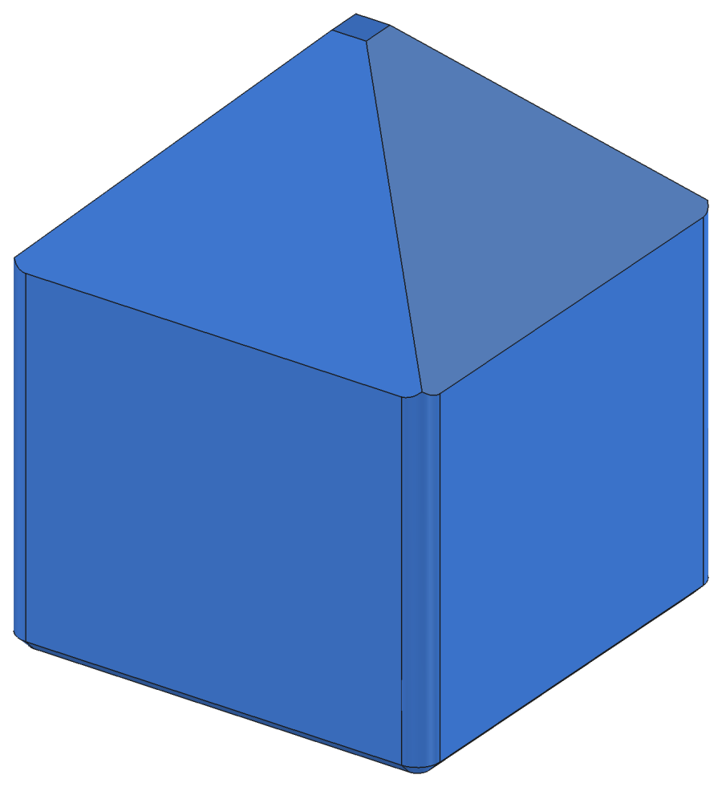
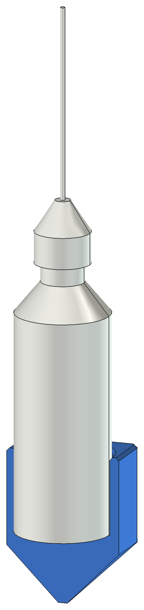
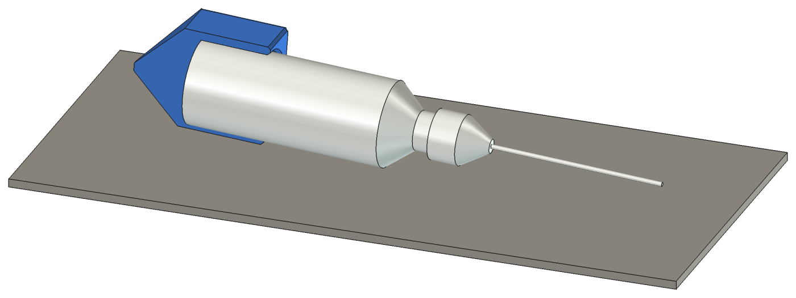

# Squeeze bottle base

A 3D-printable cap for the 1 oz needle-tip squeeze bottles used at the glassblowing bench for knocking off a piece. It slides over the bottom of the bottle and does two things:

- **It can't stand up.** The bottom comes to a point, so the bottle can't be stood up with its metal tip pointing at someone.
- **It can't roll.** The outside is square, so the bottle lies on a flat face instead of rolling off the bench.

<p align="center">
  
  &nbsp;&nbsp;&nbsp;
  
</p>
<p align="center">
  
</p>

> [!WARNING]
> **This is a design, not a proven tool.** It has been checked in CAD and in a physics simulation, but not yet printed and used at the bench. The bottle dimensions are **estimates** for a 1.2" × 6.6" applicator bottle. Measure your own bottle and print a test ring before printing the whole base (see [Fitting your bottle](#fitting-your-bottle)). Please report back if you make one.

## Files

| File | What it is |
|---|---|
| [`design/bottle_base.stl`](design/bottle_base.stl) | The base, ready to slice and print |
| [`design/bottle_base.FCStd`](design/bottle_base.FCStd) | FreeCAD 1.x model: the parametric base plus a reference bottle |
| [`design/bottle_reference.stl`](design/bottle_reference.stl) | The estimated bottle, for checking the fit in a slicer or viewer |
| [`make_bottle_base.py`](make_bottle_base.py) | Script that builds the FreeCAD model and exports the STLs |
| [`simulate.py`](simulate.py) | PyBullet physics test: standing up, random drops and rolling |
| [`render_previews.py`](render_previews.py) | Redraws the pictures in this README from the FreeCAD model |

## The design

| Feature | Size | Why |
|---|---|---|
| Outside | 37 × 37 mm square, 48 mm tall | Flat faces stop it rolling |
| Bottle pocket | 31 mm wide, 25 mm deep | Grips the bottom inch of a 30.5 mm (1.2") bottle; the rest stays free to squeeze |
| Point | 17 mm pyramid with a 3 mm flat tip | Stops it standing up; the 45° faces print without supports |
| Walls | 3 mm at the thinnest | |
| Corners | 2 mm fillets | Kinder to hands and gloves; spreads impacts |
| Lead-in | 1 mm chamfer on the pocket mouth | Makes it easier to push the bottle in |

Lying on its side, the needle end sits about 7.5 mm above the bench, so the tip doesn't drag.

### Changing it

Every dimension lives in the **Params** spreadsheet inside `bottle_base.FCStd`. Edit a value, press **Ctrl+R**, and the model updates. Then select **Body** and use **File → Export** to save a new STL. The bottle's sizes are in the same sheet, and the pocket follows `bottle_d`.

To rebuild everything from scratch, run the script in FreeCAD (**Macro → Macros… → Execute**), or headless:

```sh
freecadcmd -c "exec(open('make_bottle_base.py').read())"
# Flatpak FreeCAD:
flatpak run --command=freecadcmd org.freecad.FreeCAD -c "exec(open('make_bottle_base.py').read())"
```

Then redraw the README pictures (this needs FreeCAD's GUI, but runs without opening a window):

```sh
QT_QPA_PLATFORM=offscreen freecad render_previews.py
# Flatpak FreeCAD:
flatpak run --env=QT_QPA_PLATFORM=offscreen org.freecad.FreeCAD render_previews.py
```

## Fitting your bottle

1. Measure the bottle's diameter **right at the bottom** with calipers. Soft bottles are often slightly narrower there than the listed size.
2. Set `bottle_d` to your measurement. `clearance` (default 0.5 mm) is how much bigger the pocket is than the bottle.
3. Print a short test ring: a 5 mm tall square with the same pocket. If it's too loose, reduce `clearance`; if it's too tight, increase it. Filled filaments (CF/GF) and annealed parts barely flex, so expect to need a little more clearance with them.

## Printing

**Orientation:** pocket side down on the bed. The pyramid faces are at 45°, and the flat ceiling inside the pocket is a short bridge most printers handle, so no supports are needed.

**Material.** It sits near hot glass and gets thrown around the bench. The bottles themselves are usually LDPE, which softens around 80–100 °C, so the base only needs to match that.

| Material | Softens around* | Notes |
|---|---|---|
| PLA | 55–60 °C | ❌ Not recommended; can warp on a warm bench |
| PETG / PETG-CF | 70–80 °C | OK if the bench only gets warm. Carbon fiber adds stiffness, not heat resistance |
| **ASA** / ASA-CF | **95–100 °C** | **Recommended.** Tough, and easy to print with an enclosure |
| Polycarbonate | 110–140 °C | Toughest; hard to print |
| **PPA-CF** | 200 °C+ annealed | Best heat resistance. Needs a hardened nozzle, very dry filament and annealing |

*Heat deflection temperature; varies by brand.

**Settings:**
- **Walls:** 4–5. On a part this small, walls do most of the work against impacts.
- **Top and bottom layers:** 5–6.
- **Infill:** 20–25% gyroid (or 25–30% cubic or grid). About 63% of the part's volume is the solid pyramid core and the pocket floor, so this setting matters for material cost. If you can't set the wall count, use about 30%.

**Not printing?** The same shape works in hardwood (drill the pocket with a 1-1/4" Forstner bit), or cast in high-temperature silicone using a printed mold.

## Physics simulation

`simulate.py` combines the base and the estimated bottle into one rigid body and runs it through [PyBullet](https://pybullet.org) with empty, half-full and full bottles. It runs the same tests on a bare bottle for comparison. It needs only [uv](https://docs.astral.sh/uv/):

```sh
./simulate.py   # about a minute
```

Results with the default design:

| Test | With base | Bare bottle |
|---|---|---|
| Lying down, flicked with a spin about its axis (up to about 3 turns/s) | Moves 0–1 mm, settles on a flat face | Rolls 4–56 cm |
| 60 random drops per fill level | Ends up flat-face down 180 of 180 times | Lands upright 2 of 180 times |
| Released standing on its point | Falls if tilted 2–5° or more; balances if set down within about 1–2° | Stands at any tilt up to 5° |

The 3 mm flat at the tip is just wide enough for someone careful to balance it. Setting `point_h` to 18 shrinks the flat to about 1 mm, so it falls at around half a degree.

**Simulation assumptions:** the masses are estimates (25 g base, 7 g bottle, 4 g cap and needle, liquid at water density), the liquid is treated as a solid, and the bottle shape is the estimated one above.

## License

[MIT](LICENSE)
